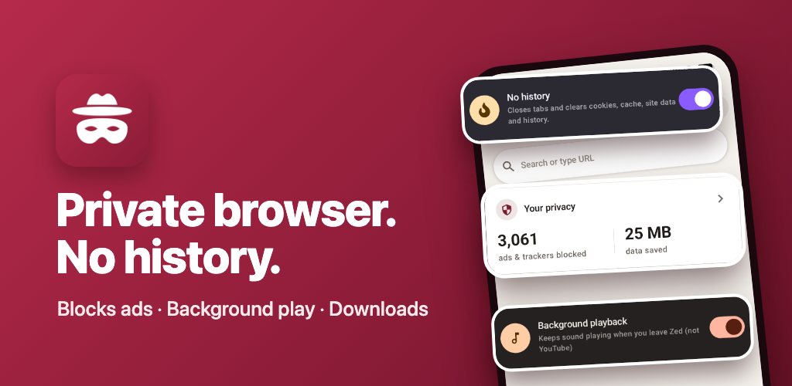
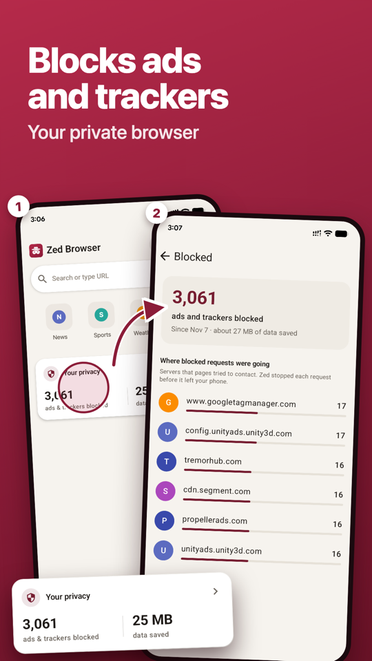
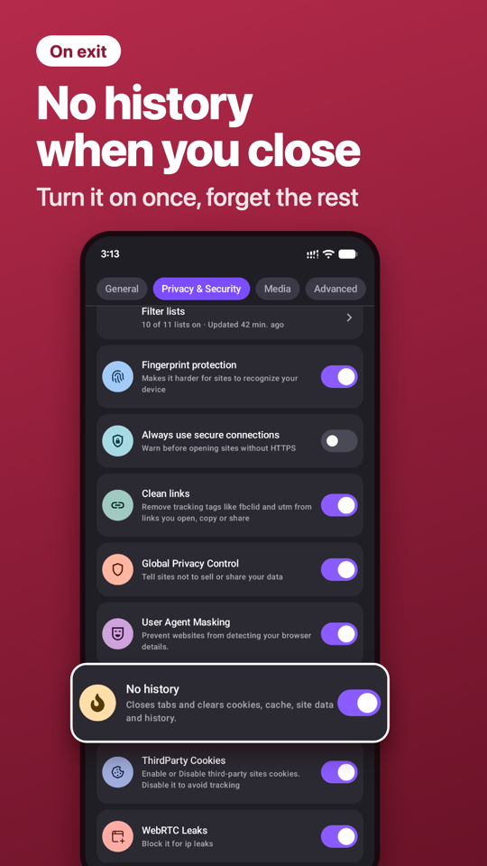
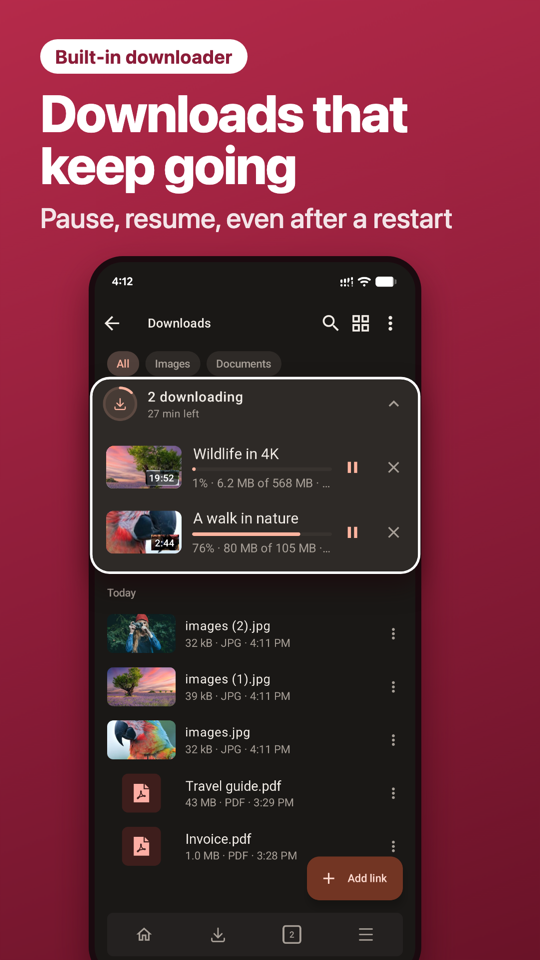
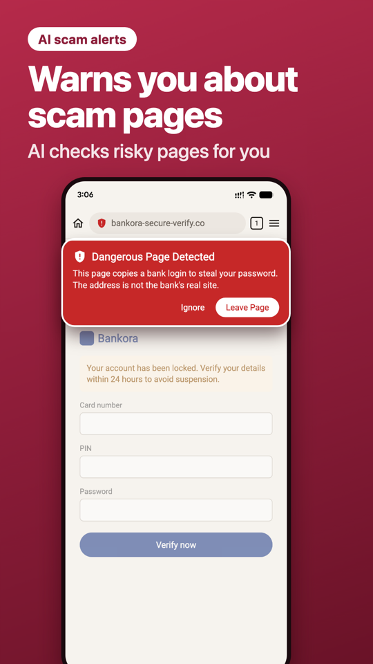

# Zed: Private Browser for Android

**Zed is a free private browser for Android that blocks ads and trackers, can forget everything when you close it, downloads files and videos, and warns you about scam pages.**

**Website:** [privatebrowserandroid.com](https://privatebrowserandroid.com/) · **Get it on Google Play:** [com.browser.red](https://play.google.com/store/apps/details?id=com.browser.red&referrer=utm_source%3Dgithub%26utm_medium%3Dreadme)

For Android phones, tablets and Chromebooks. 18 languages, including Urdu, Hindi, Arabic and Bengali.

  

---

## What Zed does

### No history mode
Turn it on and Zed clears your tabs, history, cookies, cache and site data every time you close it. It is off by default, so you choose. The **Fire button** closes all tabs and clears browsing data in one tap, and **fireproof sites** keep you signed in to the sites you trust. You can also lock Zed with your fingerprint or screen lock.

### Ad and tracker blocker, built in
On by default on every site: ads, pop-ups and trackers are blocked with filter lists that update on their own. Zed also hides cookie banners, removes tracking tags (such as `fbclid` and `utm_`) from links you open, copy or share, can block third-party cookies, and sends Global Privacy Control. If a site breaks, turn protection off for that site in one tap.
More: [ad blocker for Android](https://privatebrowserandroid.com/ad-blocker-android/) · [anti-tracking browser](https://privatebrowserandroid.com/anti-tracking-browser-android/)

### Harder to recognise
Fingerprint protection (on by default) makes your device harder for sites to recognise, and WebRTC leak protection keeps your IP address out of WebRTC requests.

### Scam and phishing warnings
Zed uses AI to check pages that look risky, such as fake login pages and scam stores, and warns you before you type a password or pay. The shield in the address bar shows safe, suspicious or dangerous.
More: [scam website detector](https://privatebrowserandroid.com/scam-website-detector-android/)

### Downloader for files and videos
Download videos from supported pages and any file from a link. Downloads pause and resume, survive restarts and wait for the connection to come back. No download limit.
More: [video downloader for Android](https://privatebrowserandroid.com/video-downloader-android/)

### Background play
Turn it on in Settings and video and audio from web pages keep playing when you leave the app.
More: [background play](https://privatebrowserandroid.com/background-play-android/)

### Everyday browsing
Tabs you swipe between, a tab strip on tablets, address bar at the top or bottom, the search engine you choose, dark mode, bookmarks and find in page.

---

## Screenshots

  
  
  
  

---

## What Zed is not

- **Not a VPN.** Websites and your internet provider can still see what you visit. With No history mode on, Zed keeps no record of it on your phone.
- No sync, no extensions, no iOS or desktop version.

Zed is free with no sign-up. Premium only adds unlimited AI (scam checks on every page and page summaries); blocking and downloads are free with no limit.

---

## Test your browser

Free online tests on the Zed website. They work in any browser, not just Zed:

- [Browser privacy test](https://privatebrowserandroid.com/browser-privacy-test/): ads, IP leaks and cross-site recognition in one check
- [Ad block test](https://privatebrowserandroid.com/ad-block-test/)
- [Browser fingerprint test](https://privatebrowserandroid.com/browser-fingerprint-test/)
- [WebRTC leak test](https://privatebrowserandroid.com/webrtc-leak-test/)

Comparing browsers? See the dated, sourced comparison: [best private browser for Android](https://privatebrowserandroid.com/best-private-browser-android/).

---

## Help and contact

- Guides: [Zed Browser help](https://privatebrowserandroid.com/help/)
- Email: [siriusa.help@gmail.com](mailto:siriusa.help@gmail.com)
- Bugs and ideas: use the [Issues tab](../../issues) of this repository
- [Privacy policy](https://privatebrowserandroid.com/privacy-policy/)

---

## License

Zed Browser is proprietary software by Sirius A Tech. This repository holds the app's description and images, not its source code. All rights reserved.
